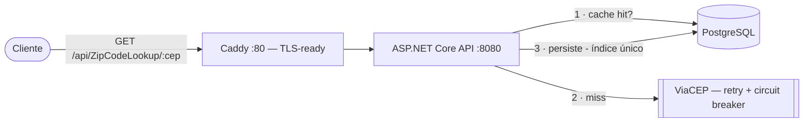

# MyCEP.API

API REST de consulta de CEP em **.NET 8**, com cache em PostgreSQL, resiliência na integração externa e infraestrutura como código. Construída como estudo de práticas de produção — não como um CRUD de exemplo.

🔗 **Demo:** <https://mycep.eduardovalente.dev> · [Swagger](https://mycep.eduardovalente.dev/) · `curl https://mycep.eduardovalente.dev/api/ZipCodeLookup/01001000`


> A demo roda no Fly.io (scale-to-zero) com Postgres serverless no Neon — a primeira requisição após ociosidade leva ~3s acordando a máquina. A pasta [infra/terraform](infra/terraform) mantém a stack AWS completa (VPC, EC2, RDS, OIDC) como referência de IaC.

---

## O que é

Dado um CEP, a API devolve o endereço completo. A estratégia é **cache-aside**: primeiro consulta o próprio banco; em *miss*, busca no [ViaCEP](https://viacep.com.br), persiste o resultado e passa a servi-lo localmente nas próximas chamadas.

```bash
curl http://localhost:8080/api/ZipCodeLookup/01001000
```

```json
{
  "id": "b3b5b50f-8c8f-4f3b-a8fa-cf6e03750df1",
  "zipcode": "01001000",
  "street": "Praça da Sé",
  "neighborhood": "Sé",
  "city": "São Paulo",
  "state": "SP",
  "ibgeCode": "3550308",
  "areaCode": "11",
  "siafiCode": "7107"
}
```

## Rodando em 30 segundos

Requer apenas Docker. Sobe API + PostgreSQL, aplica as migrations e fica pronto:

```bash
docker compose up --build
```

- API + Swagger: <http://localhost:8080/>
- Consulta: `curl http://localhost:8080/api/ZipCodeLookup/01001000`

Para rodar só o banco e subir a API pela IDE: `docker compose up postgres`.

## Arquitetura



Fluxo de uma requisição: validação do CEP (8 dígitos) → busca no Postgres → em *miss*, chamada resiliente ao ViaCEP → persistência com índice único → resposta. Erros seguem [RFC 7807 (Problem Details)](https://datatracker.ietf.org/doc/html/rfc7807) com o status correto (400 / 404 / 429 / 500).

## Decisões técnicas que valem destaque

| Área | Decisão |
|---|---|
| **Concorrência** | Índice único **parcial** (`WHERE deleted_at IS NULL`) em `zipcode` + tratamento de conflito: duas requisições simultâneas do mesmo CEP geram **uma** linha, não duplicatas. Coberto por teste de concorrência real. |
| **Resiliência** | Chamada ao ViaCEP com **retry + backoff + circuit breaker + timeout** (`AddStandardResilienceHandler`); o ViaCEP é gratuito e sem SLA. |
| **Contrato de erro** | `ProblemDetails` (RFC 7807) em toda a superfície; em 5xx o detalhe interno fica só no log, nunca no corpo. |
| **Abuso / custo** | Rate limiting nativo (60 req/min/IP) numa API pública que faz fan-out para terceiro e escreve por *miss*. |
| **Cache HTTP** | `Cache-Control: public, max-age=86400` — CEP é imutável; deixa CDN/browser absorverem a maioria dos round-trips. |
| **Testes** | **Integração com PostgreSQL real via Testcontainers** (não in-memory), incluindo corrida de inserção e ViaCEP fora do ar. |
| **Infra como código** | Terraform provisiona VPC, EC2, RDS privado e deploy via **OIDC (sem access keys)**, com senha do banco gerada e guardada no **SSM Parameter Store**. |
| **CI/CD** | Testes como *gate* antes do deploy; scans de dependências (`dotnet list --vulnerable`), imagem (Trivy) e segredos (gitleaks); Dependabot. |

## Stack

- **.NET 8** · ASP.NET Core Web API
- **Entity Framework Core 9** + Npgsql · **PostgreSQL 16**
- **Refit** + Microsoft.Extensions.Http.Resilience (Polly) para o gateway ViaCEP
- **xUnit** · Moq · FluentAssertions · **Testcontainers**
- **Docker** (multi-stage, Alpine, non-root) · Caddy (proxy TLS)
- **Terraform** (AWS: VPC, EC2, RDS, SSM, IAM/OIDC) · **GitHub Actions**

## Estrutura

```
src/MyCEP.API
├── Core/API              Controllers, middleware de erro (ProblemDetails)
├── Core/Features         Casos de uso e DTOs de resposta
└── Core/Shared
    ├── Domain            Entidades de domínio e contratos (repositório, serviço)
    └── Infrastructure    EF Core, gateway ViaCEP (Refit), IoC, migrations
test/
├── MyCEP.API.UnitTest         Casos de uso e regras de domínio
└── MyCEP.API.IntegrationTest  API ponta a ponta com Postgres real (Testcontainers)
infra/terraform               VPC, EC2, RDS, SSM, IAM/OIDC
```

## Testes

```bash
dotnet test                              # unitários + integração
dotnet test test/MyCEP.API.UnitTest      # só unitários (rápido, sem Docker)
```

Os testes de integração sobem um PostgreSQL efêmero via Testcontainers — precisam do Docker rodando. Cobertura com quality gate: `./run-coverage.ps1`.

## Endpoints

| Método | Rota | Descrição |
|---|---|---|
| `GET` | `/api/ZipCodeLookup/{cep}` | Endereço do CEP (aceita `01001000` ou `01001-000`) |
| `GET` | `/health` | Liveness + readiness (valida o Postgres) |
| `GET` | `/health/live` | Liveness (não toca o banco) |
| `GET` | `/` | Swagger UI |

## Licença e uso

**© 2025-2026 Eduardo Valente — Todos os direitos reservados.**

Este repositório é público para **leitura e avaliação técnica**, não é software
livre. Ler o código, executá-lo localmente para avaliação e citar trechos com
atribuição é permitido; copiar para outro projeto, apresentar como trabalho
próprio, redistribuir ou usar em produção exige **autorização prévia por
escrito**.

Detalhes em [LICENSE](LICENSE) e [AUTORIA.md](AUTORIA.md).
Solicitações de uso: **eduardocvalente1@hotmail.com**
